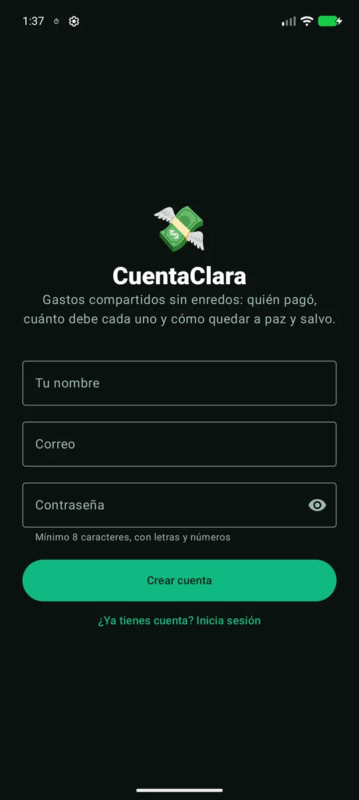
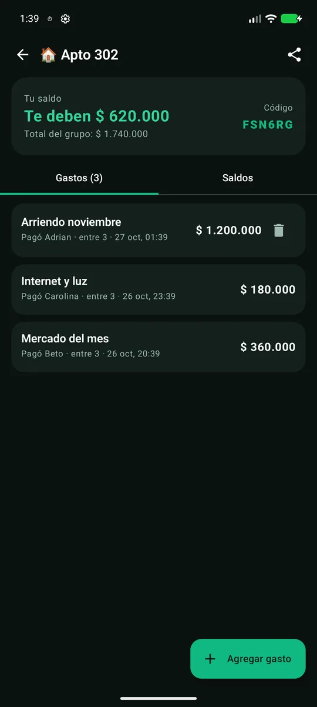
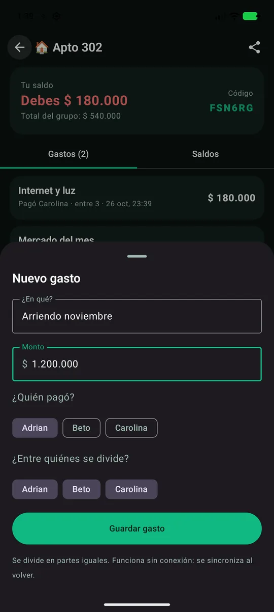
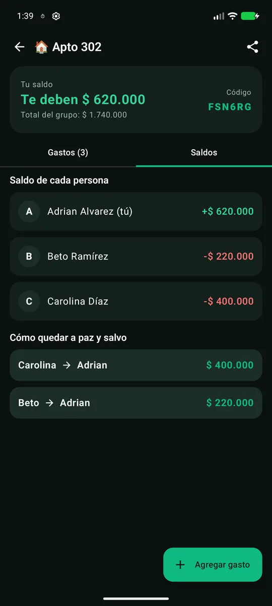
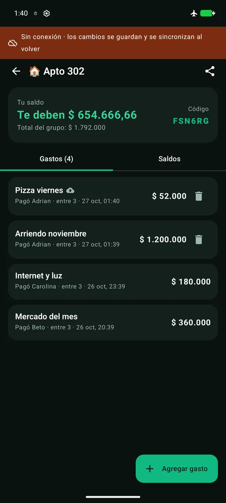

# CuentaClara 💸

App Android **full-stack** para **gastos compartidos** entre parejas, roomies o amigos: cada quien
registra lo que pagó, la app calcula **cuánto debe cada uno** y propone **la menor cantidad de
transferencias** para quedar a paz y salvo. Sincroniza en **tiempo real** con Firebase y funciona
**sin conexión**.


| Registro | Gastos en tiempo real | Nuevo gasto | Saldos y liquidación | Sin conexión |
|:---:|:---:|:---:|:---:|:---:|
|  |  |  |  |  |

---

## Tabla de contenido

- [Qué problema resuelve](#qué-problema-resuelve)
- [Funcionalidades](#funcionalidades)
- [Stack tecnológico](#stack-tecnológico)
- [Arquitectura](#arquitectura)
- [Modelo de datos y reglas de seguridad](#modelo-de-datos-y-reglas-de-seguridad)
- [Manejo de errores y modo offline](#manejo-de-errores-y-modo-offline)
- [Ejecutar con los emuladores de Firebase](#ejecutar-con-los-emuladores-de-firebase)
- [Usar un proyecto real de Firebase](#usar-un-proyecto-real-de-firebase)
- [Pruebas](#pruebas)

## Qué problema resuelve

En los gastos de un apartamento compartido o un viaje siempre alguien pierde la cuenta. CuentaClara
lleva el registro en la nube para todo el grupo y responde la única pregunta importante: *¿quién le
paga a quién y cuánto?*

## Funcionalidades

- 🔐 **Cuenta** con correo y contraseña (Firebase Auth), validación de contraseña y mensajes de error claros.
- 👥 **Grupos** con ícono; **invitación por código** de 6 caracteres (sin letras confusas como 0/O, 1/I) que se comparte por cualquier app.
- 🧾 **Gastos** con quién pagó y entre quiénes se divide, en partes iguales y **en centavos** (sin errores de redondeo).
- ⚖️ **Saldos** por persona y **liquidación mínima**: el mayor deudor le paga al mayor acreedor (máximo *n − 1* transferencias).
- ⚡ **Tiempo real**: los gastos de los demás aparecen al instante (`addSnapshotListener` → `callbackFlow`).
- 📴 **Offline-first**: caché persistente de Firestore; los gastos creados sin red quedan marcados como *pendientes* y se suben al volver.
- 🔔 **Notificaciones push** (FCM): el token del dispositivo se guarda por usuario y hay un canal "Gastos del grupo".
- 🔒 **Sesión cifrada** con `EncryptedSharedPreferences` (AES-256, clave maestra en Android Keystore).

## Stack tecnológico

| Área | Tecnología |
|------|------------|
| Lenguaje | Kotlin 2.0, Coroutines, Flow (`callbackFlow`, `combine`, `flatMapLatest`) |
| UI | Jetpack Compose, Material 3, Navigation Compose, `ModalBottomSheet` |
| Arquitectura | Clean Architecture (data / domain / presentation) + MVVM |
| DI | Hilt |
| Backend | Firebase Auth, Cloud Firestore (reglas de seguridad), Firebase Cloud Messaging |
| Seguridad local | AndroidX Security Crypto (`EncryptedSharedPreferences`, `MasterKey`) |
| Pruebas | JUnit 4, MockK, kotlinx-coroutines-test, Firebase Local Emulator Suite |

## Arquitectura

```
presentation   AuthScreen · GroupsScreen · GroupScreen (+ ViewModels)  ── StateFlow ──► Compose
                     │
domain         Balances (saldos + liquidación) · retryWithBackoff · parseAmountToCents
               SignIn · SignUp · SignOut · AddExpense (validaciones)
               AuthRepository · GroupRepository · SessionStore · ConnectivityMonitor (interfaces)
                     ▲
data           FirebaseAuthRepository · FirestoreGroupRepository (snapshot listeners, reintentos)
               EncryptedSessionStore · AndroidConnectivityMonitor · ExpenseMessagingService (FCM)
```

## Modelo de datos y reglas de seguridad

```
users/{uid}                      name, email, fcmTokens[]
groups/{groupId}                 name, emoji, inviteCode, memberIds[], memberNames{uid: name}, createdBy
groups/{groupId}/expenses/{id}   description, amountCents, paidBy, splitAmong[], createdBy, createdAt
invites/{code}                   groupId
```

Las reglas ([`firestore.rules`](firestore.rules)) garantizan que:

- Solo los **miembros** leen un grupo y sus gastos.
- Un grupo se encuentra **solo con su código** (`invites/{code}` admite `get`, no `list`).
- Quien no es miembro solo puede **agregarse a sí mismo** al grupo (se valida el `diff` de campos).
- Nadie crea gastos **a nombre de otro** (`createdBy == request.auth.uid`) ni con montos ≤ 0, y solo el autor los borra.

Verificado contra el emulador: un usuario ajeno recibe **403** al leer el grupo, sus gastos o listar invitaciones, y un
miembro recibe **403** al intentar crear un gasto con `createdBy` de otra persona.

## Manejo de errores y modo offline

- **Reintentos con *backoff* exponencial** (`retryWithBackoff`: 3 intentos, 0,5 s → 1 s) solo para errores transitorios
  (`UNAVAILABLE`, `DEADLINE_EXCEEDED`, red caída); los de permisos o validación fallan de inmediato con un mensaje claro.
- **Escrituras sin red**: Firestore las aplica al caché local al instante; la app espera hasta 4 s la confirmación del
  servidor y, si no llega, deja el gasto en cola marcado como pendiente en lugar de bloquear la pantalla.
- **Banner de conectividad** global alimentado por `ConnectivityManager.NetworkCallback`.
- Estados de carga en cada acción y validación de formularios antes de llamar a Firebase.

## Ejecutar con los emuladores de Firebase

No necesitas una cuenta de Firebase: sin `google-services.json`, la compilación *debug* usa un proyecto de demostración
(`demo-cuentaclara`) contra el **Firebase Local Emulator Suite**.

```bash
# 1. Emuladores de Auth y Firestore (requiere Node.js y Java 11+); aplica firestore.rules
npx firebase-tools emulators:start --project demo-cuentaclara --only auth,firestore

# 2. App en un emulador de Android (se conecta a 10.0.2.2)
./gradlew :app:installDebug
```

La interfaz de los emuladores queda en http://localhost:4000 para ver usuarios y documentos.

## Usar un proyecto real de Firebase

1. Crea un proyecto en la [consola de Firebase](https://console.firebase.google.com/) y una app Android con el paquete
   `com.cordobot.cuentaclara`.
2. Descarga `google-services.json` en `app/` (el plugin se activa solo si el archivo existe).
3. Habilita **Authentication → Correo/contraseña**, crea **Firestore** y publica las reglas: `npx firebase-tools deploy --only firestore:rules`.
4. Para avisar a los demás miembros de un gasto nuevo, despliega una Cloud Function que escuche
   `groups/{groupId}/expenses/{expenseId}` y envíe un mensaje FCM a los `fcmTokens` de los otros miembros
   (los tokens ya se registran desde la app).

## Pruebas

```bash
./gradlew :app:testDebugUnitTest
```

- `BalancesTest`: reparto con centavos sobrantes, liquidación mínima con tres personas, grupo sin deudas.
- `ParsingTest`: montos escritos al estilo colombiano (`45.000`, `12,50`, `1.234.567`) y códigos de invitación.
- `UseCaseTest` (MockK): reintentos solo ante errores transitorios, validación del registro antes de llamar a Firebase y
  guardado del correo en el almacén cifrado, montos convertidos a centavos.

---

Desarrollado por **Adrián Alvarez** ([@Cordobot](https://github.com/Cordobot)).

© 2026 Adrián Alvarez. Todos los derechos reservados.
